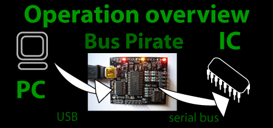

# Bus Pirate

>
> THIS REPOSITORY IS ONLY FOR THE OLD BUS PIRATE v3.x and v4.x HARDWARE!
>
> If you own a Bus Pirate 5 or later, please see https://buspirate.com
>

The Bus Pirate is an open source hacker multi-tool that talks to electronic
stuff.  It's got a bunch of features an intrepid hacker might need to
prototype their next project.

This community firmware was forked from the official Dangerous Prototypes
firmware for these devices.  This repository represents the hard work of
community members to sustain and continue the legacy of the Bus Pirate v3 and
v4 devices.

Public domain (Creative Commons Zero) source: prototype with the Bus Pirate,
then use the code in your project however you want — see [LICENSE](LICENSE).

## What works

The firmware covers the classic Bus Pirate tool set: 1-Wire, UART (including
half-duplex single-wire), I2C, SPI, the raw 2-Wire and 3-Wire buses, PC
keyboard, PIC, direct I/O, the SUMP logic analyzer, the BASIC script engine,
the v4 AVRISP-MKII programmer and the JTAG host paths (OpenOCD, and the v4
XSVF player).  The shared prompt adds the ADC, AUX/PWM/frequency and
self-test controls.  An LCD adapter and the v4 SMPS add-on are optional
builds.  Both the v3 and v4 boards are supported; [docs/SPEC.md](docs/SPEC.md)
shows each function's availability and v3/v4 differences.

## Documentation

The documentation lives under **[docs/](docs/)**.  The specification owns the
full capability matrix and links every set:

* **[docs/SPEC.md](docs/SPEC.md)** — the specification: every mode, function
  and sub-function (for example UART *and* HDUART) with its v3/v4 status.
  Planned items are marked `tbi`.
* **[docs/generic/](docs/generic/)** — how to use the prompt: navigation,
  formatting, values, macros, wrappers, reads and reset.
* **[docs/TEMPLATE.md](docs/TEMPLATE.md)** — the page template and presentation
  rules used by the documentation sets.

Sets are grouped by cluster:

| Cluster | Covers |
|---|---|
| [docs/protocol/](docs/protocol/) | bus and host protocols |
| [docs/tools/](docs/tools/) | self-contained tools that ride a protocol |
| [docs/capabilities/](docs/capabilities/) | hardware capabilities |
| [docs/programmers/](docs/programmers/) | programmer personalities |
| [docs/core/](docs/core/) | firmware internals (maintainer-facing) |
| [docs/dev/](docs/dev/) | build, flash, bootloaders and tooling (maintainer-facing) |

## Application support

The Bus Pirate is used through a simple terminal interface; these programs can
drive it for specific jobs (each covered in the set for the function it
drives):

* [AVRDude] — AVR programming via the built-in AVRISP-MKII personality (BPv4)
* [OpenOCD] — JTAG debugging (binary JTAG mode)
* [flashrom] — BIOS/flash programming
* [sigrok/PulseView] — logic analyzer (SUMP)
* [`picprog`](docs/programmers/pic/picprog.md) — PIC programming

## Purchasing

> If you're looking to purchase an old Bus Pirate v3, or v4.. don't
> spend over $30-40 USD. Spend your hard-earned cash on a Bus Pirate 5+ https://buspirate.com

* Bus Pirate v4.0 - *Newer, more space for bigger firmwares*
  * Worldwide: amazon.com has some overpriced old stock boards.

* Bus Pirate v3.6 - *Long-standing design*
  * Worldwide: amazon.com has some overpriced old stock boards.
  * Europe: <https://www.robotshop.com/uk/bus-pirate-v36a.html>
  * USA: <https://anibit.com/product/ptt07001>

## Firmware

The firmware is built and flashed with the steps in
[docs/dev/](docs/dev/README.md) — see [building](docs/dev/building.md) and
[flashing](docs/dev/flashing.md).

[OpenOCD]: http://openocd.org
[AVRDude]: http://www.nongnu.org/avrdude
[flashrom]: https://www.flashrom.org/Flashrom

## Hardware design files

Original schematics, Eagle boards and SketchUp models for the v3/v3.5/v3.6/v4
revisions are in [hardware/](hardware/); the hardware licence is
[hardware/COPYING.TXT](hardware/COPYING.TXT) (CC BY-SA 3.0).
